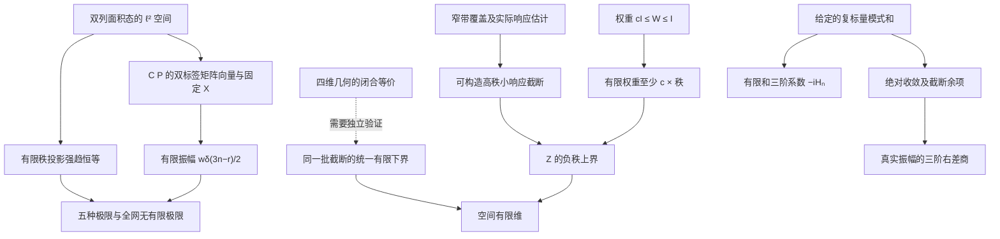

# 原文、核验推导与 Lean 定理索引

每条 Lean 数学定理的状态均为 **严格验证**，条件定理证明的是完整的“若……则……”命题。对引力的适用性另列于报告。每行链接到实际声明。机器展开的完整签名和传递公理在 [逐条审计输出](evidence/axioms.log)。正文中的“模型实例”指同一抽象算符模型。几何条件和标量级数的物理来源见[假设清单](ASSUMPTIONS.md)。独立复核把五种极限重新写成矩阵元、把强收敛重新写成范数误差，并直接检验三阶导数的阶乘。[审查用例](review/Regression.lean)

共 16 个证明模块，145 条公开定理。下图给出三条主推导。实线表示工程中能检查的数学步骤，虚线标出应用到原文所需的物理输入。

## 希尔伯特空间及有限投影

（4.29），D.2 的有限截断。[原论文 v1](https://arxiv.org/html/2611.34924v1#S4.E29) · [前两阶段推导](../phase2/DERIVATION.md)

| Lean 定理 | 对应的数学步骤 |
| --- | --- |
| [`NullCone.Model.diag_apply`](NullCone/Hilbert.lean#L37) | 坐标乘子作用 |
| [`NullCone.Model.perm_apply`](NullCone/Hilbert.lean#L56) | 指标置换作用 |
| [`NullCone.Model.ket_inner`](NullCone/Hilbert.lean#L61) | 基矢读取分量 |
| [`NullCone.Model.proj_apply`](NullCone/Hilbert.lean#L67) | 投影保留选中分量 |
| [`NullCone.Model.proj_idem`](NullCone/Hilbert.lean#L70) | 投影幂等 |
| [`NullCone.Model.proj_symmetric`](NullCone/Hilbert.lean#L74) | 投影的内积对称性 |
| [`NullCone.Model.proj_eq_sum`](NullCone/Hilbert.lean#L79) | 投影等于有限基展开 |
| [`NullCone.Model.proj_strong_of_cofinal`](NullCone/Hilbert.lean#L85) | 共尾有限集上的投影在范数中趋于原向量 |

## 面积、翻转、双边制备与提升

（5.25），（5.30c），（5.31），（5.33）–（5.37a）的模型实例。[原论文 v1](https://arxiv.org/html/2611.34924v1#S5.E31) · [前两阶段推导](../phase2/RECHECK.md)

| Lean 定理 | 对应的数学步骤 |
| --- | --- |
| [`NullCone.Model.area_apply`](NullCone/Model.lean#L17) | 面积对角作用 |
| [`NullCone.Model.area_symmetric`](NullCone/Model.lean#L21) | 面积对称 |
| [`NullCone.Model.swap_swap`](NullCone/Model.lean#L30) | 标签翻转两次回到原标签 |
| [`NullCone.Model.flip_apply`](NullCone/Model.lean#L31) | 单侧翻转的坐标作用 |
| [`NullCone.Model.observable_apply`](NullCone/Model.lean#L32) | 双侧负翻转的坐标作用 |
| [`NullCone.Model.flip_involution`](NullCone/Model.lean#L35) | 单侧翻转是对合 |
| [`NullCone.Model.observable_involution`](NullCone/Model.lean#L37) | 双侧观测量是对合 |
| [`NullCone.Model.observable_symmetric`](NullCone/Model.lean#L39) | 观测量对称 |
| [`NullCone.Model.w_pos`](NullCone/Model.lean#L50) | 共同高斯权重严格为正 |
| [`NullCone.Model.q_sq`](NullCone/Model.lean#L51) | 制备系数的平方等于权重 |
| [`NullCone.Model.gaussian`](NullCone/Model.lean#L53) | 原高斯在两个面积值上相等 |
| [`NullCone.Model.cap_weight`](NullCone/Model.lean#L57) | 制备内积给出加权内积 |
| [`NullCone.Model.rightPhase_unit`](NullCone/Model.lean#L61) | 相对相位模为一 |
| [`NullCone.Model.boost_phase_from_area`](NullCone/Model.lean#L64) | 去除整体相位后的右腿提升 |
| [`NullCone.Model.boost_isometry`](NullCone/Model.lean#L77) | 提升保范 |
| [`NullCone.Model.proj_area_commute`](NullCone/Model.lean#L82) | 投影与面积对易 |
| [`NullCone.Model.proj_weight_commute`](NullCone/Model.lean#L85) | 投影与权重对易 |
| [`NullCone.Model.packet_apply`](NullCone/Model.lean#L94) | 双指标有限制备的分量 |
| [`NullCone.Model.packet_inner`](NullCone/Model.lean#L103) | 有限关联向量与任意双边向量的内积 |
| [`NullCone.Model.prepared_matrix`](NullCone/Model.lean#L109) | 制备向量等于实际 C P 的矩阵系数 |
| [`NullCone.Model.boost_packet`](NullCone/Model.lean#L116) | 提升对实际制备的作用 |
| [`NullCone.Model.delta_pos`](NullCone/Model.lean#L125) | 参考响应严格为正 |

## 高斯算符的谱演算

（5.25），（5.30c）的两面积实例。[原论文 v1](https://arxiv.org/html/2611.34924v1#S5.E25) · [前两阶段推导](../phase2/RECHECK.md)

| Lean 定理 | 对应的数学步骤 |
| --- | --- |
| [`NullCone.Model.area_polynomial`](NullCone/Area.lean#L9) | 面积满足二次多项式 |
| [`NullCone.Model.area_spectrum_subset`](NullCone/Area.lean#L18) | 实谱包含于两个面积值 |
| [`NullCone.Model.q_exp`](NullCone/Area.lean#L31) | 正平方根的显式指数 |
| [`NullCone.Model.weight_is_gaussian`](NullCone/Area.lean#L37) | 连续函数演算给出高斯权重 W |
| [`NullCone.Model.cap_is_gaussian`](NullCone/Area.lean#L44) | 连续函数演算给出高斯制备 C |
| [`NullCone.Model.area_ket`](NullCone/Area.lean#L52) | 两个正交本征族的面积本征方程 |

## 投影、实际插入及算符性质

（4.29），（5.30c）–（5.31），（5.37a）。[原论文 v1](https://arxiv.org/html/2611.34924v1#S5.E37) · [前两阶段推导](../phase2/RECHECK.md)

| Lean 定理 | 对应的数学步骤 |
| --- | --- |
| [`NullCone.Model.ket_orthonormal`](NullCone/Projections.lean#L9) | 坐标基正交归一 |
| [`NullCone.Model.model_infinite`](NullCone/Projections.lean#L13) | 同一单侧空间无限维 |
| [`NullCone.Model.model_open`](NullCone/Projections.lean#L17) | 同一模型任意外态上的开放恒等拼接及绝对求和 |
| [`NullCone.Model.proj_range`](NullCone/Projections.lean#L25) | 投影的像等于有限基张成空间 |
| [`NullCone.Model.proj_finite_rank`](NullCone/Projections.lean#L43) | 投影有限秩且秩等于标签数 |
| [`NullCone.Model.proj_selfAdjoint`](NullCone/Projections.lean#L52) | 投影自伴 |
| [`NullCone.Model.area_selfAdjoint`](NullCone/Projections.lean#L55) | 面积自伴 |
| [`NullCone.Model.observable_selfAdjoint`](NullCone/Projections.lean#L58) | 双边观测量自伴 |
| [`NullCone.Model.cap_adjoint_cap`](NullCone/Projections.lean#L61) | 算符恒等式 C†C=W |
| [`NullCone.Model.weight_coercive`](NullCone/Projections.lean#L66) | 权重的实际二次型为 w 乘范数平方 |
| [`NullCone.Model.rightBoost_unitary`](NullCone/Projections.lean#L69) | 右腿提升满射且保范 |
| [`NullCone.Model.signed_is_matrix_element`](NullCone/Projections.lean#L80) | 带符号闭合等于固定 X 的实际矩阵元 |
| [`NullCone.Model.flip_selfAdjoint`](NullCone/Projections.lean#L85) | 单侧翻转自伴 |
| [`NullCone.Model.observable_norm_le_one`](NullCone/Projections.lean#L90) | 双边观测量的算符范数至多为一 |
| [`NullCone.Model.insertion_selfAdjoint`](NullCone/Projections.lean#L95) | 同一有符号插入自伴 |

## 两面积模型的有限截断公式

（5.31）–（5.32），（5.37a）的显式检验。[原论文 v1](https://arxiv.org/html/2611.34924v1#S5.E31) · [前两阶段推导](../phase2/RECHECK.md)

| Lean 定理 | 对应的数学步骤 |
| --- | --- |
| [`NullCone.Model.mass_labels`](NullCone/Amplitude.lean#L13) | 未归一化制备的质量 |
| [`NullCone.Model.change_labels`](NullCone/Amplitude.lean#L51) | 提升前后实际观测量的期望差 |
| [`NullCone.Model.signed_labels`](NullCone/Amplitude.lean#L68) | 同一有符号插入的有限公式 |
| [`NullCone.Model.unitPacket_norm`](NullCone/Amplitude.lean#L81) | 实际归一化关联向量的范数 |
| [`NullCone.Model.unitPacket_response`](NullCone/Amplitude.lean#L93) | 归一化期望等于期望差除以质量 |
| [`NullCone.Model.normalized_labels`](NullCone/Amplitude.lean#L98) | 有限截断的归一化响应 |
| [`NullCone.Model.reference_pair_norm`](NullCone/Amplitude.lean#L108) | 单对参考态的单位范数 |
| [`NullCone.Model.reference_pair_response`](NullCone/Amplitude.lean#L113) | 单对参考态的实际响应为 δ |

## 五种穷尽与强收敛

（5.37b）–（5.38）的穷尽问题。[原论文 v1](https://arxiv.org/html/2611.34924v1#S5.E38) · [前两阶段推导](../phase2/RECHECK.md)

| Lean 定理 | 对应的数学步骤 |
| --- | --- |
| [`NullCone.Model.right_le_left`](NullCone/Cutoffs.lean#L21) | 每条路径的左标签数至少等于右标签数 |
| [`NullCone.Model.stages_mono`](NullCone/Cutoffs.lean#L24) | 投影支撑逐级递增 |
| [`NullCone.Model.stages_cofinal`](NullCone/Cutoffs.lean#L29) | 五组有限集各自在包含序上共尾 |
| [`NullCone.Model.stages_strong`](NullCone/Cutoffs.lean#L35) | 五组对一切固定向量强趋恒等 |
| [`NullCone.Model.stages_nested`](NullCone/Cutoffs.lean#L39) | 较大投影包含较小投影的像 |

## 同一有符号插入的五种极限

检验（5.38）向（5.39）的推理。[原论文 v1](https://arxiv.org/html/2611.34924v1#S5.E38) · [前两阶段推导](../phase2/RECHECK.md)

| Lean 定理 | 对应的数学步骤 |
| --- | --- |
| [`NullCone.Model.rank_stages`](NullCone/Limits.lean#L9) | 每种截断的实际秩 |
| [`NullCone.Model.signed_by_route`](NullCone/Limits.lean#L17) | 五组同一插入的逐项精确值 |
| [`NullCone.Model.balanced_limit`](NullCone/Limits.lean#L29) | 平衡组趋正无穷 |
| [`NullCone.Model.positive_limit`](NullCone/Limits.lean#L33) | 第二组趋正有限参考值 |
| [`NullCone.Model.zero_limit`](NullCone/Limits.lean#L36) | 第三组趋零 |
| [`NullCone.Model.negative_limit`](NullCone/Limits.lean#L39) | 第四组趋负有限值 |
| [`NullCone.Model.dilute_limit`](NullCone/Limits.lean#L42) | 稀释组趋负无穷 |
| [`NullCone.Model.reference_match`](NullCone/Limits.lean#L46) | 第二组每一项即等于正参考值 |
| [`NullCone.Model.no_finite_cut_net_limit`](NullCone/Limits.lean#L52) | 全体有限标签集的网没有有限极限 |

## 无限维反例的合并陈述

（4.29）与（5.37）–（5.39）的逻辑关系。[原论文 v1](https://arxiv.org/html/2611.34924v1#S5.E38) · [前两阶段推导](../phase2/RECHECK.md)

| Lean 定理 | 对应的数学步骤 |
| --- | --- |
| [`NullCone.Model.weight_trace_infinite`](NullCone/Counterexample.lean#L8) | 模型中高斯权重的普通正迹为无穷 |
| [`NullCone.Model.positive_route_normalized_limit`](NullCone/Counterexample.lean#L13) | 给正有限值的一组，其归一化响应趋 δ/2 |
| [`NullCone.Model.open_gluing_with_incompatible_closures`](NullCone/Counterexample.lean#L28) | 无限维、开放求和与两条不相容闭合穷尽在同一模型中成立 |

## 开放求和、普通正迹及有符号负界

（4.29），（5.30c），（5.37）–（5.39），D.2、E。[原论文 v1](https://arxiv.org/html/2611.34924v1#S5.E38) · [前两阶段推导](../phase2/DERIVATION.md)

| Lean 定理 | 对应的数学步骤 |
| --- | --- |
| [`NullCone.Trace.cutWeight_le_positiveTrace`](NullCone/Trace.lean#L31) | 每个有限截断受正迹上确界控制 |
| [`NullCone.Trace.cutWeight_eq_trace_compression`](NullCone/Trace.lean#L40) | 有限正交族的权重等于压缩算符的通常矩阵迹 |
| [`NullCone.Trace.cutWeight_adjoint_comp_self`](NullCone/Trace.lean#L49) | C†C 的有限权重等于像向量平方范数之和 |
| [`NullCone.Trace.cutWeight_ge_rank`](NullCone/Trace.lean#L59) | 有限截断权重至少为 c 乘秩 |
| [`NullCone.Trace.positiveTrace_eq_trace`](NullCone/Trace.lean#L75) | 有限维时上确界等于普通线性迹的非负实值 |
| [`NullCone.Trace.positiveTrace_eq_top_of_infinite_family`](NullCone/Trace.lean#L97) | 存在无限正交族且有正下界时正迹无穷 |
| [`NullCone.Trace.finiteDimensional_of_positiveTrace_ne_top`](NullCone/Trace.lean#L113) | 正下界与有限正迹推出有限维 |
| [`NullCone.Trace.positiveTrace_ne_top_iff_finiteDimensional`](NullCone/Trace.lean#L124) | 统一严格正下界下的充要条件 |
| [`NullCone.Trace.open_matrix_elements`](NullCone/Trace.lean#L139) | 任意 Hilbert 基开放矩阵元的绝对求和与范数界 |
| [`NullCone.Trace.l2_open_and_closed`](NullCone/Trace.lean#L155) | 同一 ℓ² 恒等算符满足开放公式且普通正迹无穷 |
| [`NullCone.Trace.signedClosure_le_neg_rank`](NullCone/Trace.lean#L170) | 未归一化有符号量的负秩界 |
| [`NullCone.Trace.signedCut_le_neg_rank`](NullCone/Trace.lean#L182) | 实际有限截断权重的负秩界 |
| [`NullCone.Trace.rank_bound_of_signed_lower`](NullCone/Trace.lean#L189) | 统一有限下界给出秩上界 |
| [`NullCone.Trace.signedClosure_no_uniform_lower`](NullCone/Trace.lean#L199) | 秩无界排除统一有限下界 |
| [`NullCone.Trace.signedClosure_tendsto_atBot`](NullCone/Trace.lean#L211) | 秩趋无穷时有符号网趋负无穷 |
| [`NullCone.Trace.signedClosure_no_finite_limit`](NullCone/Trace.lean#L225) | 每个尾部可取任意大秩时排除有限极限 |

## 普通双边矩阵向量与 Hilbert–Schmidt 条件

（5.30c）–（5.31），D.2、E.3。[原论文 v1](https://arxiv.org/html/2611.34924v1#S5.E31) · [前两阶段推导](../phase2/DERIVATION.md)

| Lean 定理 | 对应的数学步骤 |
| --- | --- |
| [`NullCone.HilbertSchmidt.column_sum_basis_independent`](NullCone/HilbertSchmidt.lean#L53) | 列平方和与单侧 Hilbert 基无关 |
| [`NullCone.HilbertSchmidt.positiveTrace_gram_eq_column_sum`](NullCone/HilbertSchmidt.lean#L66) | 一般 C 的普通正迹等于列范数平方总和 |
| [`NullCone.HilbertSchmidt.finite_trace_iff_hilbertSchmidt`](NullCone/HilbertSchmidt.lean#L99) | 有限迹等价于 Hilbert–Schmidt 列条件 |
| [`NullCone.HilbertSchmidt.positiveTrace_gram_eq_matrix_sum`](NullCone/HilbertSchmidt.lean#L105) | 扩展迹等于双标签矩阵系数平方和 |
| [`NullCone.HilbertSchmidt.finite_trace_iff_matrix_vector`](NullCone/HilbertSchmidt.lean#L116) | 有限迹等价于完整矩阵向量存在 |
| [`NullCone.HilbertSchmidt.finiteDimensional_iff_matrix_vector_of_lower`](NullCone/HilbertSchmidt.lean#L128) | 有正下界时矩阵向量存在等价于有限维 |
| [`NullCone.HilbertSchmidt.positiveTrace_eq_vector_norm_sq`](NullCone/HilbertSchmidt.lean#L136) | 矩阵向量的范数平方等于迹 |
| [`NullCone.HilbertSchmidt.normalized_matrix_iff`](NullCone/HilbertSchmidt.lean#L160) | 可归一化充要条件包括 C 非零 |

## 有限制备的响应与面积二阶矩

（5.32），（D.22）–（D.25）。[原论文 v1](https://arxiv.org/html/2611.34924v1#S5.E32) · [前两阶段推导](../phase2/DERIVATION.md)

| Lean 定理 | 对应的数学步骤 |
| --- | --- |
| [`NullCone.Response.expectation_sub_le`](NullCone/Response.lean#L19) | 一般单位向量的期望差界 |
| [`NullCone.Response.phase_norm`](NullCone/Response.lean#L39) | 提升相位模为一 |
| [`NullCone.Response.phase_sub_one_le`](NullCone/Response.lean#L42) | 相位弦长不超过弧长 |
| [`NullCone.Response.integrated_phase_square_le`](NullCone/Response.lean#L59) | 任意实轴正测度的积分相位界 |
| [`NullCone.Response.rightBoost_apply`](NullCone/Response.lean#L83) | 右腿对角提升的坐标作用 |
| [`NullCone.Response.rightBoost_norm`](NullCone/Response.lean#L86) | 对角提升保持 ℓ² 范数 |
| [`NullCone.Response.boost_distance_sq_le`](NullCone/Response.lean#L104) | 实际提升距离平方的二阶矩上界 |
| [`NullCone.Response.rightBoost_uncentered`](NullCone/Response.lean#L118) | 中心化与非中心化提升只差整体相位 |
| [`NullCone.Response.boost_response_le`](NullCone/Response.lean#L138) | 固定单位向量的实际响应含有系数 abs(η)/π |

## 有限截断的扩充与带外权重

（D.24）–（D.25），特定截断上的（5.37b）。[原论文 v1](https://arxiv.org/html/2611.34924v1#A4.E25) · [前两阶段推导](../phase2/DERIVATION.md)

| Lean 定理 | 对应的数学步骤 |
| --- | --- |
| [`NullCone.Dilution.exists_infinite_band`](NullCone/Dilution.lean#L19) | 有限个子空间的联合张成稠密且全空间无限维时，至少一带无限维 |
| [`NullCone.Dilution.exists_band_extension`](NullCone/Dilution.lean#L34) | 在无限维窄带与原截断的正交补中选取任意多个新正交态 |
| [`NullCone.Dilution.exists_diluted_cut`](NullCone/Dilution.lean#L90) | 构造包含指定有限维 E 的真实截断，给出秩和带外投影的质量界 |
| [`NullCone.Dilution.outside_sum_basis_independent`](NullCone/Dilution.lean#L132) | 带外投影在同一有限截断上的对角和与基无关 |
| [`NullCone.Dilution.weighted_moment_le`](NullCone/Dilution.lean#L156) | 带外占比与各权重上下界控制有限归一化偏差矩 |
| [`NullCone.Dilution.exists_cut_fraction_and_moment`](NullCone/Dilution.lean#L185) | 实际扩充截断的带外比重和有限加权矩同时受控 |
| [`NullCone.Dilution.spread_le_of_invariant_band`](NullCone/Dilution.lean#L208) | 利用不变窄带与正交分解控制中心化面积的平方偏差 |
| [`NullCone.Dilution.compressed_weight_eigenbasis`](NullCone/Dilution.lean#L253) | 实际压缩权重的正交本征基及本征值上下界 |
| [`NullCone.Dilution.normalizedMoment_eq_eigen_sum`](NullCone/Dilution.lean#L289) | 实际算符乘积压缩迹定义的归一化矩等于本征基加权和 |
| [`NullCone.Dilution.exists_cut_operator_moment`](NullCone/Dilution.lean#L313) | 无须截断与权重或面积对易即可构造包含原截断的高秩低矩子空间 |
| [`NullCone.Dilution.exists_high_rank_operator_cut`](NullCone/Dilution.lean#L332) | 含任意旧截断且秩任意大的子空间，其实际压缩迹矩可按指定比例压低 |
| [`NullCone.Dilution.finiteDimensional_of_band_cover_and_closing`](NullCone/Dilution.lean#L355) | 从有限窄带覆盖、算符响应界与同族闭合下界直接推出有限维 |

## 小响应截断的有限维充分条件

（5.32），（5.37b）–（5.39），（D.24）–（D.25）。[原论文 v1](https://arxiv.org/html/2611.34924v1#S5.E38) · [前两阶段推导](../phase2/RECHECK.md)

| Lean 定理 | 对应的数学步骤 |
| --- | --- |
| [`NullCone.Dimension.exists_orthonormal_fin`](NullCone/Dimension.lean#L21) | 从无限维空间构造任意长度的有限正交归一族 |
| [`NullCone.Dimension.finiteDimensional_of_cofinal_small_cuts`](NullCone/Dimension.lean#L38) | 统一闭合下界与可选高秩小响应族推出有限维 |
| [`NullCone.Dimension.finiteDimensional_of_cofinal_small_cuts_limit`](NullCone/Dimension.lean#L59) | 同一族的有限极限版本 |
| [`NullCone.Dimension.exists_narrow_band_parameters`](NullCone/Dimension.lean#L76) | 选择固定窄带宽度及循环长度 |
| [`NullCone.Dimension.finiteDimensional_of_narrow_band_cuts`](NullCone/Dimension.lean#L103) | 固定窄带参数和同族闭合下界推出有限维 |
| [`NullCone.Dimension.finiteDimensional_of_narrow_band_limit`](NullCone/Dimension.lean#L125) | 固定窄带和同族有限极限推出有限维 |

## 有限正泛函的另一条充分条件

对闭合权重的加强假设，对照附录 E.1、E.3。[原论文 v1](https://arxiv.org/html/2611.34924v1#A5) · [前两阶段推导](../phase2/RECHECK.md)

| Lean 定理 | 对应的数学步骤 |
| --- | --- |
| [`NullCone.Functional.cutProjection_isStarProjection`](NullCone/Functional.lean#L27) | 有限族张成空间的实际正交投影 |
| [`NullCone.Functional.positiveTrace_le_functional_one`](NullCone/Functional.lean#L41) | 普通正迹由有限正泛函在恒等上的值控制 |
| [`NullCone.Functional.finiteDimensional_of_weighted_functional`](NullCone/Functional.lean#L54) | 全体有限投影的计权条件与正下界推出有限维 |

## 精确标量级数及硬截断微扰系数

（4.33）与其后的（4.34）。[原论文 v1](https://arxiv.org/html/2611.34924v1#S4.E33) · [前两阶段推导](../report/mathematics.tex)

| Lean 定理 | 对应的数学步骤 |
| --- | --- |
| [`NullCone.Series.mode_norm`](NullCone/Series.lean#L44) | 单模式的精确范数 |
| [`NullCone.Series.amplitude_absolute_sum`](NullCone/Series.lean#L54) | 绝对收敛且绝对和精确等于 π²x²/12 |
| [`NullCone.Series.cutoff_tendsto`](NullCone/Series.lean#L62) | 实际有限振幅趋于真实模式和 |
| [`NullCone.Series.dilogSeries_absolute`](NullCone/Series.lean#L68) | 闭单位盘上的二重对数幂级数绝对收敛 |
| [`NullCone.Series.amplitude_eq_dilog`](NullCone/Series.lean#L76) | 振幅的二重对数级数形式 |
| [`NullCone.Series.amplitude_tail_le`](NullCone/Series.lean#L112) | 保留前 N 项的误差上界 |
| [`NullCone.Series.cutoff_cubic`](NullCone/Series.lean#L193) | 有限截断实际三阶实导数除以 6 |
| [`NullCone.Series.cutoff_cubic_scaled`](NullCone/Series.lean#L199) | 恢复耦合变量后的实际三阶系数 |
| [`NullCone.Series.cubic_log_limit`](NullCone/Series.lean#L214) | 负虚部减 log N 趋于欧拉常数 |
| [`NullCone.Series.cubic_diverges`](NullCone/Series.lean#L219) | 有限截断三阶系数的负虚部无界 |
| [`NullCone.Series.cubic_no_finite_limit`](NullCone/Series.lean#L225) | 三阶截断系数不存在有限复极限 |

## 移除截断后的实际函数

（4.33）的三阶差商，比较（4.34）。[原论文 v1](https://arxiv.org/html/2611.34924v1#S4.E33) · [前两阶段推导](../report/mathematics.tex)

| Lean 定理 | 对应的数学步骤 |
| --- | --- |
| [`NullCone.Perturbation.amplitude_quadratic_limit`](NullCone/Perturbation.lean#L31) | 真实振幅除以 x² 的双侧去心极限为 π²/12 |
| [`NullCone.Perturbation.amplitude_im_cubic_atBot`](NullCone/Perturbation.lean#L107) | 无穷和虚部的三阶右差商沿整个正侧趋于负无穷 |
| [`NullCone.Perturbation.amplitude_im_cubic_sequence`](NullCone/Perturbation.lean#L133) | 指定正序列上的真实三阶虚部差商趋于负无穷 |
| [`NullCone.Perturbation.amplitude_no_cubic_coefficient`](NullCone/Perturbation.lean#L142) | 减去二阶项后的无穷和没有有限复三阶右系数 |
